<p align="center">
  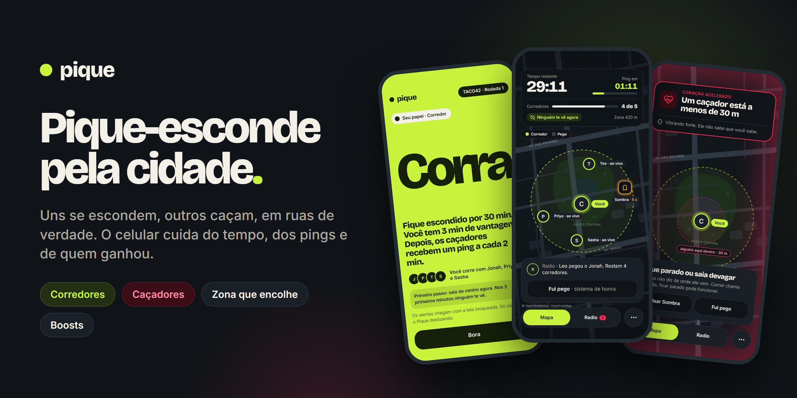
</p>

<h1 align="center">Pique</h1>

<p align="center">
  <b>Pique-esconde pela cidade.</b> Uns se escondem, outros caçam, em ruas de verdade.<br>
  O celular cuida do tempo, dos pings e de quem ganhou.
</p>

<p align="center">
  <a href="https://pique.expo.app"><b>Jogar no navegador</b></a> ·
  <a href="#como-jogar">Como jogar</a> ·
  <a href="#instalar-e-jogar">Instalar</a> ·
  <a href="#rodar-o-projeto">Rodar o projeto</a>
</p>

<p align="center">
  
  
  
  
</p>

---

## O que é

O Pique é o pique-esconde (e o pique-pega) levado para a rua, com o celular de juiz. Uma pessoa cria a partida, marca a zona no mapa e manda o código para a crew. O app sorteia quem corre e quem caça, dá a vantagem dos corredores e, a cada poucos minutos, solta um **ping**: os caçadores veem onde cada corredor estava naquele instante. Ganha quem se esconder até o fim do tempo, ou os caçadores, se pegarem todo mundo antes.

Ninguém fica olhando a localização de ninguém o tempo todo. Os caçadores só enxergam os corredores nos pings, e a localização só é enviada enquanto a rodada está rolando.

## Como jogar

1. **Crie a partida** e compartilhe o código de 6 letras (ou o QR) com a crew.
2. **Marque a zona** no mapa: o círculo onde todo mundo tem que ficar.
3. **Escolha o lado** (corredor, caçador ou sorteio) e ajuste as regras da casa: duração, vantagem, intervalo do ping, zona que encolhe, boosts e o que mais quiserem.
4. **Comece.** Os corredores têm alguns minutos de vantagem para sumir. Depois os caçadores são liberados.
5. **Pings:** a cada intervalo, os caçadores recebem a posição de cada corredor naquele momento.
6. **Pegou?** O caçador marca o corredor e o corredor confirma no celular dele. Sem resposta em 60 s, conta como pego.
7. **Fim:** quando o tempo acaba (corredores vencem) ou quando não sobra ninguém (caçadores vencem). Dá para pedir revanche com a mesma crew.

## O que tem no jogo

| | |
|---|---|
| **Mapa de ruas de verdade** | Ruas, praças, rios e prédios do lugar onde vocês estão (OpenStreetMap), no visual escuro do Pique. |
| **Zona que encolhe** | O círculo diminui de tempos em tempos, com 1 min de aviso. Quem fica 30 s fora aparece ao vivo para os caçadores. |
| **Coração acelerado** | O celular do corredor vibra no ritmo de um coração quando um caçador chega a menos de 30 m, sem dizer de onde. |
| **Grito** | O caçador faz o celular do corredor mais perto tocar um som. Se estiver perto, ele se entrega. 3 por rodada. |
| **Boosts** | Aparecem pelo mapa durante a caça. Pegar deixa você visível por uns segundos, e você guarda até 2. **Sombra** some do próximo ping, **Despiste** solta um ping falso a 60 m e **Escudo** protege da pega por 2 min. |
| **Salvar o amigo** | Quem é pego fica preso no lugar. Um corredor que chegar a 10 m e ficar 3 s solta o amigo, e os dois voltam para o jogo. |
| **Radio** | Canal de cada time, com respostas prontas e áudio curto. |
| **Avisos com o celular no bolso** | Ping, coração acelerado, grito, pega e fim da rodada chegam como notificação. |
| **Molduras** | Cosméticos em volta da sua foto no mapa. Só visual: ninguém compra vantagem. |

## Telas

<table>
  <tr>
    <td>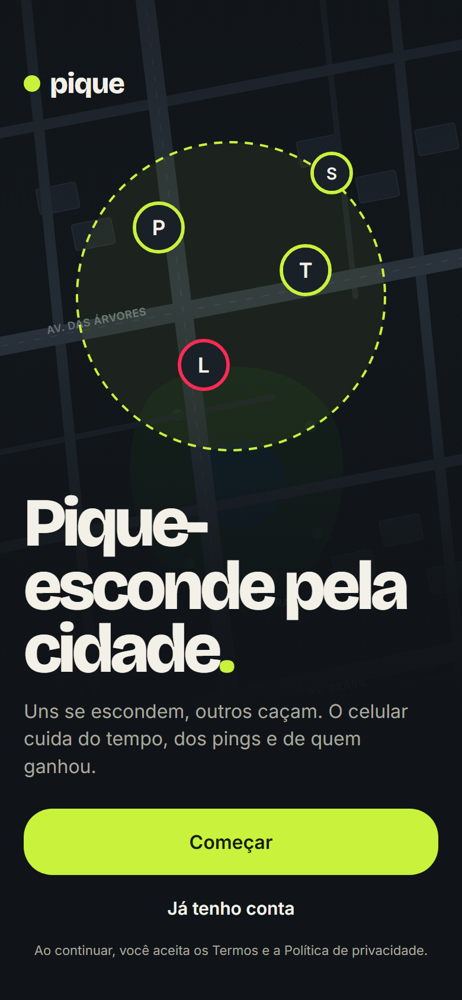</td>
    <td>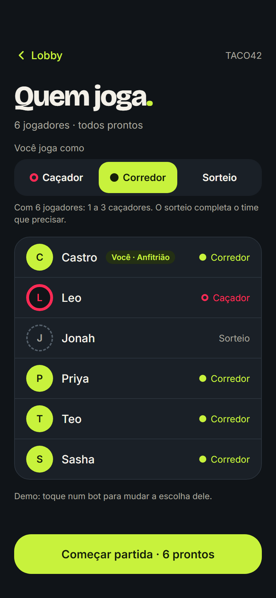</td>
    <td>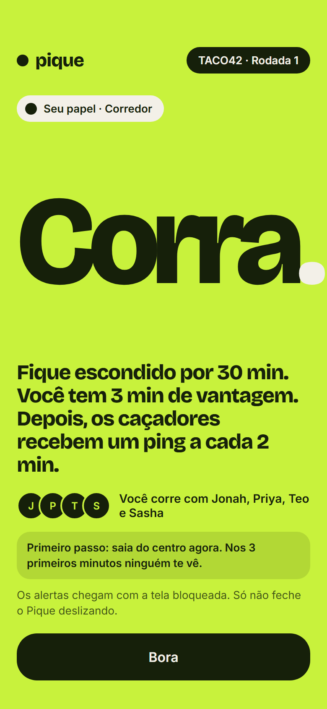</td>
    <td>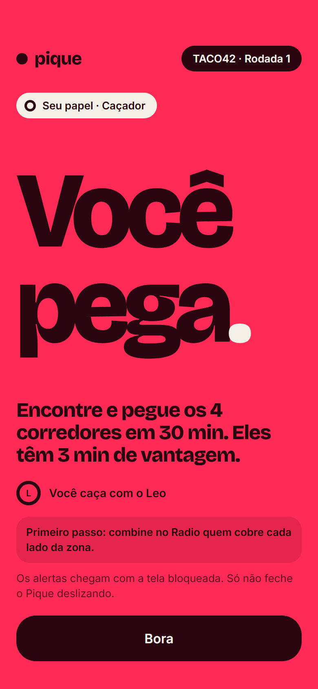</td>
  </tr>
  <tr>
    <td align="center">Boas-vindas</td>
    <td align="center">Lobby</td>
    <td align="center">Você corre</td>
    <td align="center">Você caça</td>
  </tr>
  <tr>
    <td>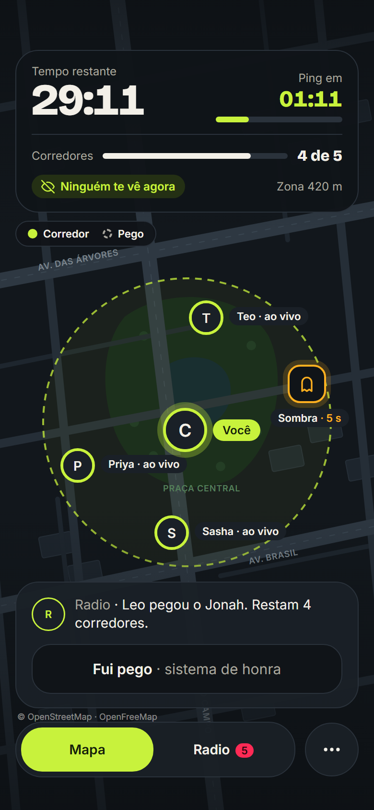</td>
    <td>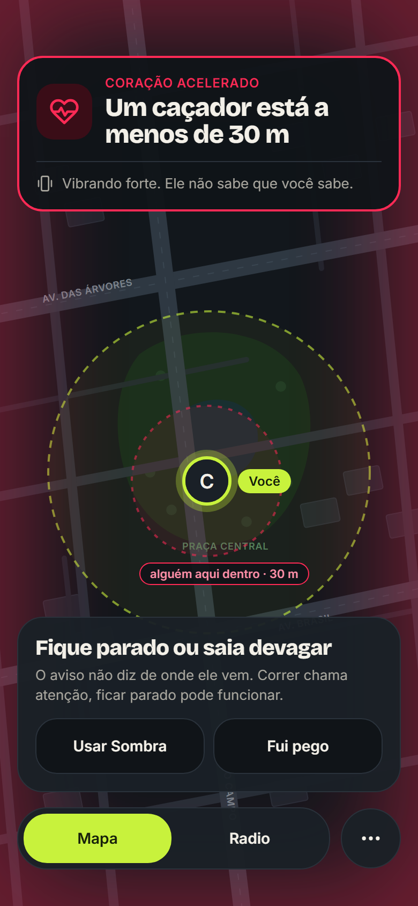</td>
    <td>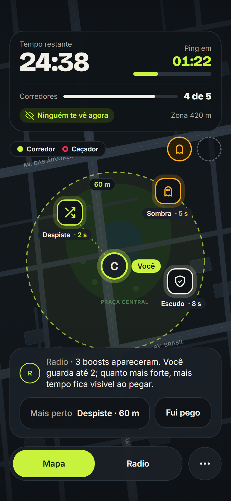</td>
    <td>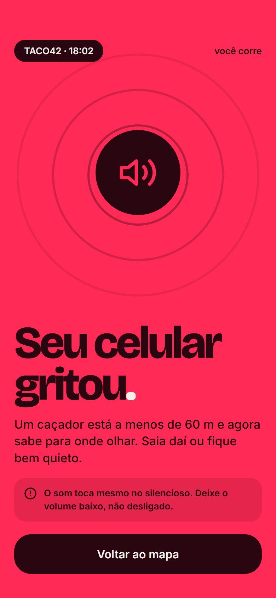</td>
  </tr>
  <tr>
    <td align="center">Mapa da partida</td>
    <td align="center">Coração acelerado</td>
    <td align="center">Boosts</td>
    <td align="center">Grito</td>
  </tr>
  <tr>
    <td>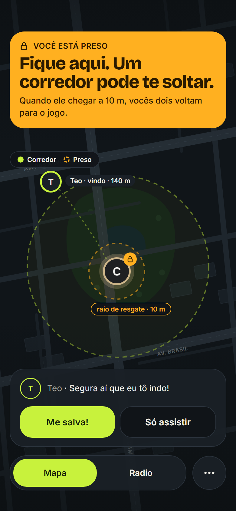</td>
    <td>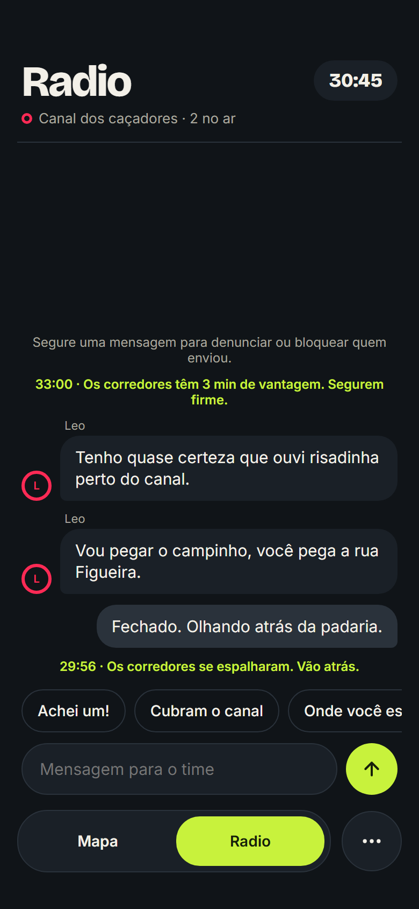</td>
    <td>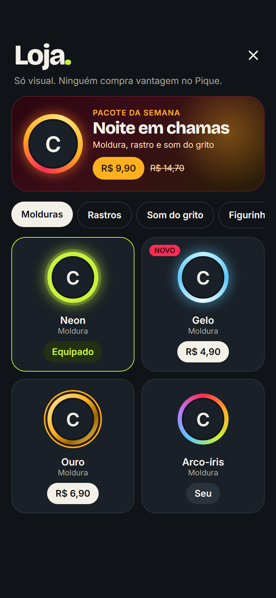</td>
    <td>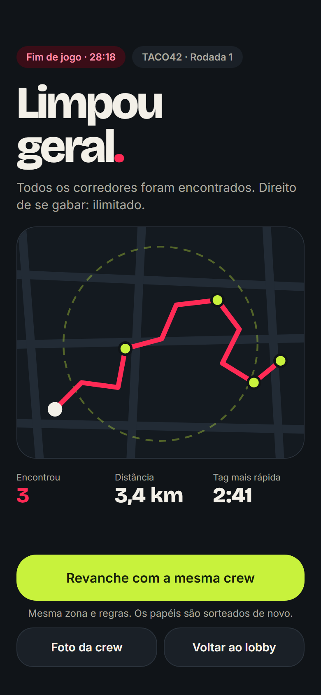</td>
  </tr>
  <tr>
    <td align="center">Salvar o amigo</td>
    <td align="center">Radio</td>
    <td align="center">Loja</td>
    <td align="center">Fim da rodada</td>
  </tr>
</table>

<sub>Imagens geradas a partir do design do app. As fotos de perfil aparecem como iniciais, igual ao app enquanto a pessoa não envia uma foto.</sub>

## Instalar e jogar

O Pique está em **beta fechado**, para jogar com os amigos.

- **iPhone (pelo navegador):** abra **[pique.expo.app](https://pique.expo.app)** no Safari, toque em Compartilhar → **Adicionar à Tela de Início** e abra pelo ícone. Assim ele abre em tela cheia e recebe os avisos da partida.
- **Android (app):** instale o APK do beta, pedindo o link para quem organiza o teste. Na primeira abertura o Android pede para permitir instalar apps dessa fonte.
- **Qualquer celular:** dá para jogar só pelo site, sem instalar nada.

Depois do nome, o app pede numa tela só as permissões: localização (durante o uso e com a tela bloqueada), avisos, microfone (para o Radio) e câmera e fotos.

### Privacidade

- **Quando a localização é enviada:** só durante a rodada, e para de ser enviada quando você é pego ou sai.
- **Quem vê o quê:** caçadores veem corredores só nos pings, ou ao vivo se o corredor ficar fora da zona. Corredores nunca veem caçadores.
- **O que é apagado:** os áudios do Radio somem no fim da rodada, e a partida inteira (posições, mensagens, avisos) é apagada 7 dias depois.

## Rodar o projeto

**Requisitos:** Node.js 20 ou mais novo e npm. Para gerar o APK, uma conta gratuita na [Expo](https://expo.dev).

```bash
git clone https://github.com/Castro-arch/pique.git
cd pique
npm install
```

### Backend (Convex)

O backend é o [Convex](https://convex.dev). Na primeira vez, o comando abaixo pede login e cria um projeto de desenvolvimento:

```bash
npx convex dev
```

Deixe esse terminal aberto. Em outro, configure as chaves do login:

```bash
npm run auth:setup
```

Opcional: para os avisos por push no site, gere chaves VAPID (`npx web-push generate-vapid-keys`) e salve no Convex com `npx convex env set` nos nomes `VAPID_PUBLIC_KEY`, `VAPID_PRIVATE_KEY` e `VAPID_SUBJECT`.

### App

Crie um arquivo `.env.local` na raiz (ele não vai para o repositório):

```bash
EXPO_PUBLIC_CONVEX_URL=https://<seu-projeto>.convex.cloud
EXPO_PUBLIC_CONVEX_SITE_URL=https://<seu-projeto>.convex.site
# Opcional, para o push do site (a mesma VAPID_PUBLIC_KEY do Convex):
EXPO_PUBLIC_VAPID_PUBLIC_KEY=
```

E rode:

```bash
npx expo start --web   # no navegador
npx expo start         # no celular com um build de desenvolvimento
```

### Testes

```bash
npm test            # regras do jogo no backend (vitest + convex-test)
npm run typecheck   # TypeScript
```

### Publicar

```bash
npx expo export -p web --output-dir dist && npx eas-cli deploy --prod   # site
npx eas-cli build --platform android --profile preview                   # APK do Android
```

## Tecnologias

- **App:** [Expo](https://expo.dev) (React Native, expo-router), no site com react-native-web
- **Backend:** [Convex](https://convex.dev): banco de dados em tempo real, funções e agendamentos (pings, zona, fim da rodada)
- **Mapa:** [MapLibre](https://maplibre.org) com o mapa de ruas do [OpenFreeMap](https://openfreemap.org) (dados do OpenStreetMap)
- **Localização em segundo plano:** expo-location e expo-task-manager
- **Avisos:** Web Push no site e notificações locais no Android (expo-notifications)

## Estrutura

```
convex/          backend: regras do jogo, rodadas, pings, boosts, avisos, Radio
  schema.ts      tabelas
  games.ts       criar, entrar, lobby, regras e zona
  rounds.ts      começo, ping, zona que encolhe, fim e limpeza
  play.ts        posição, quem vê quem, pega, coração acelerado, grito, boosts, resgate
  alerts.ts      avisos da partida (e push.ts envia para o site)
  game.test.ts   testes das regras
src/app/         telas (expo-router)
src/components/  componentes (mapa, cartões, boosts, avatar...)
src/lib/         ligação com o backend, localização, permissões, avisos
src/theme/       cores, fontes e espaçamento
public/          tela de carregamento, fontes do site e service worker (sw.js)
docs/            imagens deste README
```

## Créditos

- **Dados do mapa:** © colaboradores do [OpenStreetMap](https://www.openstreetmap.org/copyright), servidos pelo [OpenFreeMap](https://openfreemap.org) no esquema [OpenMapTiles](https://openmaptiles.org).
- **Fontes:** [Bricolage Grotesque](https://fonts.google.com/specimen/Bricolage+Grotesque) e [Inter](https://rsms.me/inter/), licença SIL Open Font License (o texto está em `public/fonts`).
- **Ícones:** [Lucide](https://lucide.dev), licença ISC.
- **Som do grito:** gerado no próprio projeto.

## Licença

Ainda não definida. Sem uma licença, o código fica disponível só para consulta.
